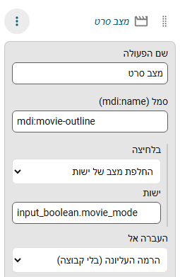

# שורות פעולה

**הוספת פעולה** בעורך מוסיפה פריט שעושה משהו כשלוחצים עליו, במקום לפתוח דף.

## מה לחיצה יכולה לעשות

| סוג | מה קורה |
|---|---|
| **החלפת מצב של ישות** | `homeassistant.toggle` על הישות, למשל `input_boolean.movie_mode` |
| **הצגת פרטי ישות** | פותחת את חלון הפרטים (more-info) של Home Assistant עבור הישות |
| **הפעלת שירות** | קוראת ל-`domain.service` (למשל `scene.turn_on` או `script.turn_on`), עם ישות לא חובה ונתוני JSON לא חובה |

נתוני השירות הם אובייקט JSON של עד 1000 תווים, למשל `{"brightness": 128}`.

נותנים לשורה שם וסמל. אפשר לשים שורת פעולה בקבוצה, להצמיד אותה, ולתת לה מספרים, צבע סמל, [כללי מצב](items.md) וכלל "הצגה רק כש...". היא **לא יכולה להיות לשונית**.

## הרשאות

פעולה רצה בשם המשתמש המחובר, ולכן ההרשאות של Home Assistant חלות. כשל מוצג כהודעה של Home Assistant עצמה.

השורה לא פותחת דף: הלחיצה מריצה את הפעולה. שורות פעולה זמינות לכל משתמש, לא רק למנהלים.
