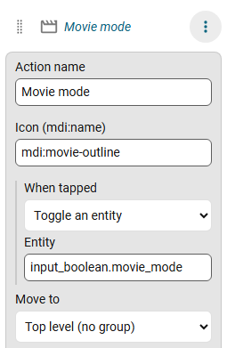

# Action rows

**Add action** in the editor adds an item that does something when you tap it, instead of opening a page.

## What a tap can do

| Type | What happens |
|---|---|
| **Toggle an entity** | `homeassistant.toggle` on the entity, for example `input_boolean.movie_mode` |
| **Show entity details** | opens Home Assistant's more-info dialog for the entity |
| **Call a service** | calls `domain.service` (for example `scene.turn_on` or `script.turn_on`), with an optional entity and optional JSON data |

Service data is a JSON object of at most 1000 characters, for example `{"brightness": 128}`.

Give the row a name and an icon. An action row can be grouped and pinned, and can have badges, an icon colour, [state rules](items.md#icon-and-colour-by-state) and a show-only-when rule. It **cannot be a tab**.

## Permissions

An action runs as the signed-in user, so Home Assistant's own permissions apply. A failure shows as Home Assistant's own message.

The row does not open a page: the tap runs the action. Actions are for any user, not only admins.
