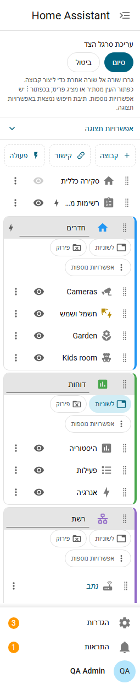
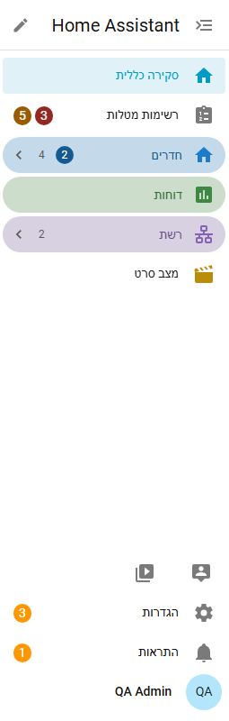
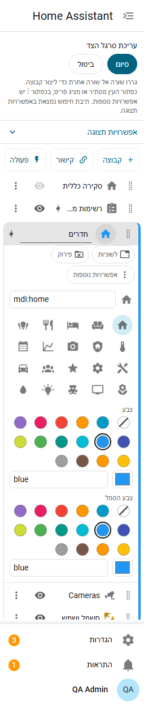
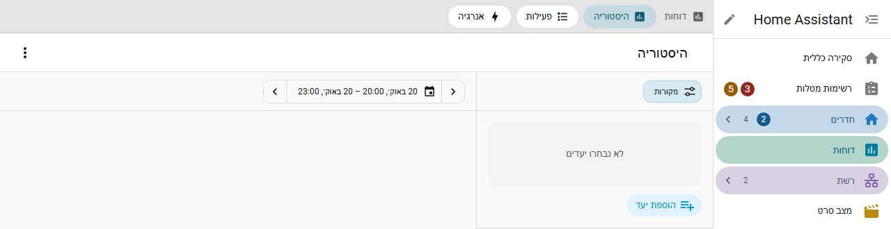
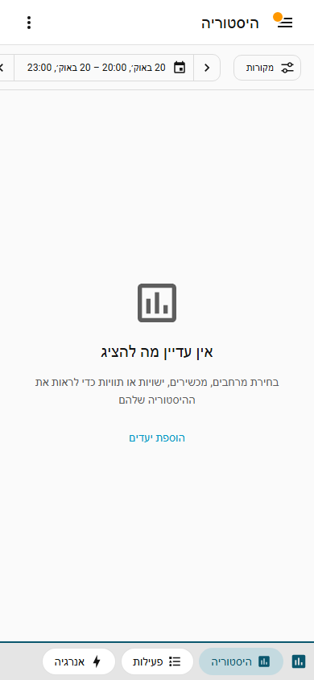

# קבוצות ועריכה

## מצב עריכה

לוחצים על **העיפרון** ליד כותרת סרגל הצד. רשימת הלוחות הופכת לעורך ולכל שורה יש ידית גרירה.

- גוררים שורה **אל** שורה אחרת כדי ליצור קבוצה עם שתיהן. מקלידים את השם מיד.
- גוררים שורה אל כותרת של קבוצה כדי להוסיף אותה לקבוצה.
- גוררים בין שורות כדי להזיז. קבוצות שלמות זזות לפי הידית שלהן.
- כפתור **העין** מסתיר או מציג לוח. זו אותה רשימת הסתרה ש-Home Assistant משתמשת בה; פריטים מוסתרים נשארים ברשימת העורך, מעומעמים.
- הסמל והשם של קבוצה נערכים בשורת הקבוצה. **פירוק** מחזיר את הלוחות שלה למקומם; אין כפתור מחיקה נפרד.
- **סיום** שומר (כשלא שונה דבר הוא רק סוגר), **ביטול** זורק את השינויים.
- חלון "עריכת סרגל הצד" של Home Assistant, שנפתח בלחיצה ארוכה, ממשיך לעבוד. סדר חדש שנשמר בו מוחל על הפריסה שלכם והקבוצות נשארות.

הגרירה עובדת עם עכבר, אצבע או עט. במקלדת, ממקדים ידית ולוחצים **Alt + חץ למעלה** או **Alt + חץ למטה**; קורא מסך מקריא לאן השורה עברה.

## קיפול

לוחצים על כותרת של קבוצה כדי לקפל או לפתוח אותה. קבוצה מקופלת שמכילה את הדף שבו אתם נמצאים מודגשת. קבוצה מקופלת מציגה את מספר הפריטים שבה (אפשר להסתיר ב[אפשרויות תצוגה](settings.md)) ואת המספרים על הפריטים שלה, מסוכמים.

## צבעים וסגנונות כותרת

פותחים את הסמל של קבוצה בעורך כדי לתת לה **צבע** (השם שלה והקו שלצד הפריטים) ו**צבע סמל**.

- בוחרים באחד מצבעי ערכת הנושא של Home Assistant, שעוקבים אחרי ערכת הנושא במצב בהיר וכהה, או בכל צבע `#rrggbb`.
- אם צבע היה קשה לקריאה בערכת הנושא שלכם הוא מוכהה או מובהר בדיוק במידה הנדרשת (WCAG AA).
- ב**אפשרויות תצוגה** כותרות הקבוצות יכולות להיות **רגילות**, עם **רקע צבעוני**, עם **קו מעל** או **מעוגלות עם רקע**, והקו שלצד הפריטים שבקבוצה אפשר להציג או להסתיר. ראו [הגדרות וערכות נושא](settings.md).

## אפשרויות קיפול

ב**אפשרויות תצוגה**:

- **הקבוצות מתחילות מקופלות**: בכל טעינה של הדף, חוץ מקבוצות שכפתור התיקייה הפתוחה שלהן מופעל. קיפול של קבוצה לא נשמר.
- **קבוצה אחת פתוחה בכל פעם**: פתיחת קבוצה מקפלת את האחרות.
- **כפתור קיפול ופתיחה של הכול ליד הכותרת**: כבוי כברירת מחדל, כי הוא מקצר את הכותרת.
- **קבוצה שמתחילה פתוחה**: כש"הקבוצות מתחילות מקופלות" דלוק, בכל שורת קבוצה יש כפתור תיקייה פתוחה. קבוצות שהוא לחוץ בהן מתחילות פתוחות בכל טעינה והשאר מקופלות. עם "קבוצה אחת פתוחה בכל פעם" רק הראשונה מהן נפתחת.

מה קובע את הקיפול בטעינת דף:

1. "הקבוצות מתחילות מקופלות" דלוק: הכפתורים "פתוחה בטעינה" קובעים. קיפול במהלך הביקור לא נשמר.
2. "הקבוצות מתחילות מקופלות" כבוי: כל קבוצה נשארת כפי שהשארתם אותה, ונזכרת לכל משתמש בכל מכשיר. הכפתורים "פתוחה בטעינה" אינם משפיעים ומוסתרים.

## קבוצות כלשוניות

הכפתור **לשוניות** בשורת קבוצה הופך את הקבוצה ל**פריט אחד בסרגל הצד**. לחיצה עליו פותחת את הפריט הראשון בקבוצה, או את זה שהיה פתוח אחרון בדף הזה, עם סרגל לשוניות מעל הדף: לשונית אחת לכל פריט בקבוצה.

- הדפים הם של Home Assistant עצמה, ללא שינוי. השורה של הקבוצה מודגשת בזמן שאחד מהם פתוח.
- לוח מחוונים עם כמה תצוגות שומר על לשוניות התצוגה שלו מתחת לסרגל.
- פריטים מוסתרים אינם לשוניות. שורות פעולה לא יכולות להיות לשוניות.
- הלשוניות הן קישורים: Ctrl או לחיצה באמצעית העכבר פותחות אחת בכרטיסייה חדשה בדפדפן.
- הסרגל והכותרת של הדף נשארים במקומם בזמן גלילה בדף ארוך.

### סרגל לשוניות בטלפון

בטלפונים ובמסכים צרים אחרים הלשוניות הן סרגל בתחתית המסך, עם קצה עליון צבעוני וסמל הקבוצה, כדי שלא יתבלבל עם הלשוניות של הדף עצמו. כשיש עוד לשוניות שאפשר לגלול אליהן הצידה, הסרגל דוהה בקצה הזה.

{ width="320" }

## אזור מוצמד

גוררים פריטים אל **מוצמדים למטה** בעורך. הם מופיעים כרשת צפופה של סמלים מעל "הגדרות" ו"התראות": ארבעה בשורה, או עמודה אחת כשסרגל הצד מציג סמלים בלבד. מרחפים או ממקדים סמל כדי לראות את שמו.

- עד 20 פריטים.
- במקלדת משתמשים בחצים בתוך הרשת וב-Enter לפתיחה. בעורך, Alt + חץ למטה בשורה האחרונה מצמיד אותה.
- לוחות מוצמדים שמוסתרים אינם מוצגים.

## להתחיל מחדש

בלי ברירת מחדל של מנהל, **הסרת הקבוצות והסדר המותאם** בעורך מחזירה את סרגל הצד של Home Assistant עצמה. פריטים מוסתרים נשארים מוסתרים.
