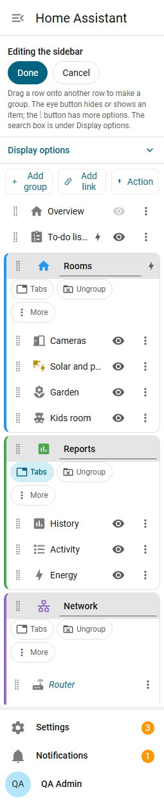
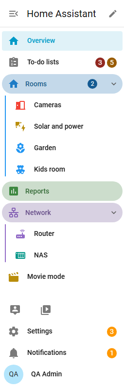
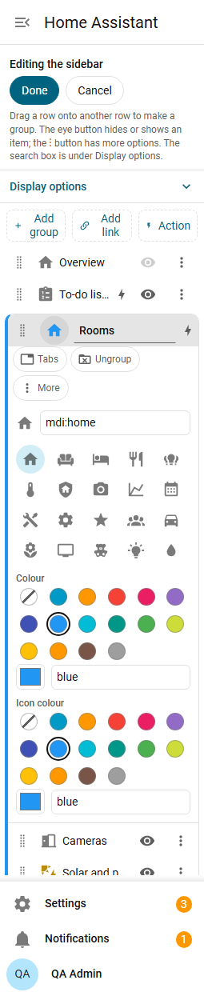
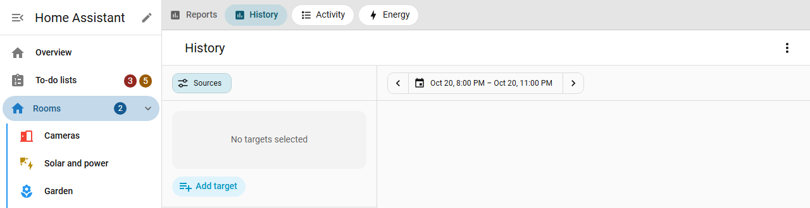
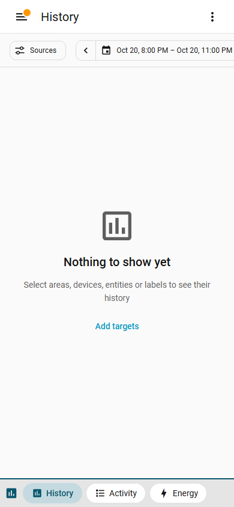

# Groups and editing

## Edit mode

Press the **pencil** next to the sidebar title. The panel list turns into an editor and every row gets a drag handle.

- Drop a row **onto** another row to create a group with both. Type the name right away.
- Drop a row onto a group header to add it to that group.
- Drop between rows to move. Whole groups move by their handle.
- The **eye** button hides or shows a panel. It is the same hidden list Home Assistant uses; hidden items stay listed in the editor, dimmed.
- A group's icon and name are edited on the group row. **Ungroup** puts its panels back in place; there is no separate delete.
- **Done** saves (with nothing changed it just closes), **Cancel** throws the changes away.
- Home Assistant's long-press "Edit sidebar" dialog still works. A new order saved there is applied to your layout and groups stay.

Drag works with a mouse, a finger or a pen. With the keyboard, focus a handle and press **Alt + Up** or **Alt + Down**; a screen reader hears where the row landed.

## Folding

Click a group header to fold or unfold it. A folded group that holds the page you are on is highlighted. A folded group shows the number of its items (this can be hidden under [Display options](settings.md)) and the badges of its items added up.

## Colours and header styles

Open a group's icon in the editor to give it a **colour** (its name and the line beside its items) and an **icon colour**.

- Choose one of Home Assistant's theme colours, which follow your theme in light and dark mode, or any `#rrggbb` colour.
- If a colour would be hard to read on your theme it is darkened or lightened just enough (WCAG AA).
- Under **Display options**, group headers can be **Plain**, **Tinted background**, **Line above** or **Rounded with background**, and the line beside grouped items can be shown or hidden. See [Settings and themes](settings.md).

## Fold options

Under **Display options**:

- **Groups start collapsed**: on every page load, except groups whose open folder button is on. Folding is then not remembered.
- **One group open at a time**: opening a group folds the others.
- **Collapse / expand all button next to the title**: off by default because it shortens the title.
- **A group that starts open**: with "Groups start collapsed" on, each group row gets an open folder button. Groups with it pressed start open on every page load, the rest start folded. With "One group open at a time" only the first of them opens.

What decides the folding when a page loads:

1. "Groups start collapsed" on: the "starts open" buttons decide. Folding during the visit is not saved.
2. "Groups start collapsed" off: each group is as you last left it, remembered per user on every device. The "starts open" buttons have no effect and are hidden.

## Groups as tabs

The **Tabs** button on a group row turns the group into **one sidebar item**. Clicking it opens the group's first item, or the one you had open last in this page, with a bar of tabs above the page: one tab per item of the group.

- The pages are Home Assistant's own, unchanged. The group's row is highlighted while any of them is open.
- A dashboard with several views keeps its own view tabs below the bar.
- Hidden items are not tabs. Action rows cannot be tabs.
- Tabs are links: Ctrl or middle click opens one in a new browser tab.
- The bar and the page's header stay in place while you scroll a long page.

### Phone tab bar

On phones and other narrow screens the tabs are a bar at the bottom of the screen, with a coloured top edge and the group's icon so it is not mistaken for a page's own tabs. When more tabs scroll sideways, the bar fades at that edge.

{ width="320" }

## Pinned area

Drag items into **Pinned at the bottom** in the editor. They appear as a compact grid of icons above Settings and Notifications: four per row, or one column when the sidebar shows icons only. Hover or focus an icon for its name.

- Up to 20 items.
- With the keyboard, use the arrow keys inside the grid and Enter to open. In the editor, Alt + Down on the last row pins it.
- Hidden pinned panels are not shown.

## Start over

Without an admin default, **Remove groups and custom order** in the editor brings back Home Assistant's own sidebar. Hidden panels stay hidden.
