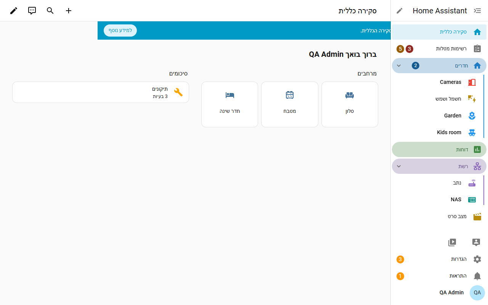
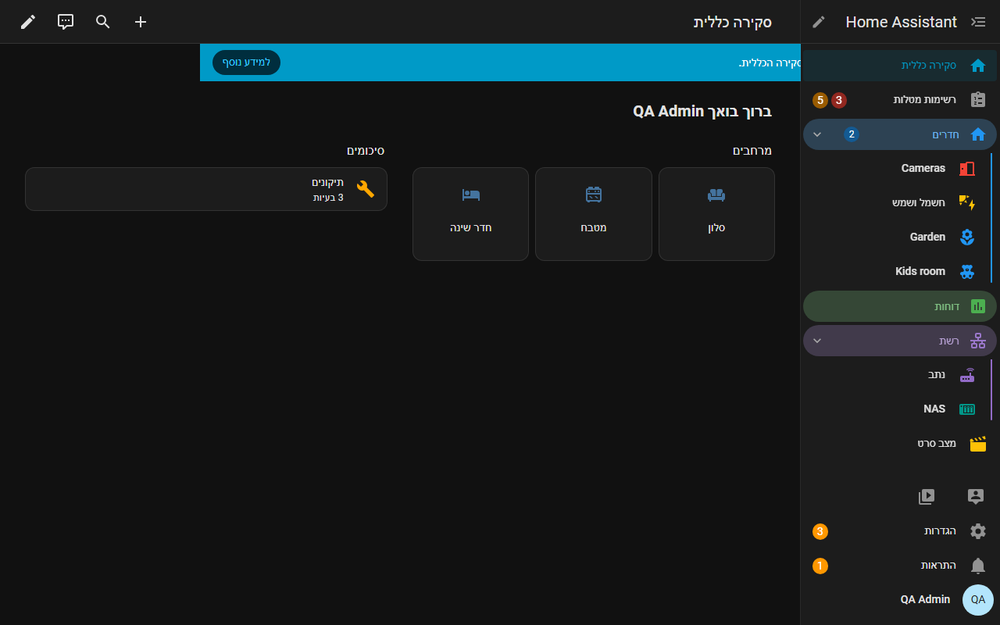

# Easy Sidebar Pro

Easy Sidebar Pro מוסיפה **קבוצות מתקפלות** לסרגל הצד של Home Assistant, והעריכה נעשית ישירות בתוך הסרגל, בגרירה. גוררים שורה אל שורה אחרת וזו קבוצה. בעברית ובאנגלית, עם תמיכה מלאה בכיוון מימין לשמאל.

[התקנה](install.md){ .md-button .md-button--primary }
[GitHub](https://github.com/bareli/easy_sidebar_pro){ .md-button }

## למה

סרגל הצד של Home Assistant הוא רשימה שטוחה אחת. כשיש הרבה לוחות מחוונים ולוחות של תוספים היא מתארכת, ו"עריכת סרגל הצד" של Home Assistant יודעת רק לסדר מחדש ולהסתיר. Easy Sidebar Pro נותנת מבנה בלי לצאת מסרגל הצד.

- **עריכה במקום.** לוחצים על העיפרון ליד כותרת הסרגל, גוררים שורות ונותנים שם לקבוצה החדשה.
- **אותה פריסה בכל מקום.** הפריסה נשמרת ב-Home Assistant עבור המשתמש שלכם ולא בדפדפן, ולכן היא עוקבת אחריכם לכל מחשב, טאבלט וטלפון ולאפליקציה הרשמית.
- **בלי הבהוב.** הקבוצות משורטטות כחלק מהסרגל של Home Assistant עצמו, ולא מודבקות עליו אחרי הטעינה.
- **ברירת מחדל למנהל.** מנהל יכול לתת לכל משתמש שלא יצר פריסה משלו את אותו סרגל צד.
- **עובדת עם ההגדרות של Home Assistant.** הסדר והלוחות המוסתרים נכתבים גם להגדרות סרגל הצד של Home Assistant עצמה.
- **בלי YAML.** מוסיפים את האינטגרציה ומשתמשים בעיפרון.

## מה אפשר לעשות

| יכולת | עמוד |
|---|---|
| קבוצות, גרירה, צבעים, סגנונות כותרת, קיפול, קבוצות לשוניות, סרגל לשוניות בטלפון, אזור מוצמד | [קבוצות ועריכה](groups.md) |
| פריטים שפותחים דף של Home Assistant או כתובת אינטרנט (נתב, NAS) | [קישורים](links.md) |
| פריטים שמחליפים מצב של ישות, מציגים את פרטיה או מפעילים שירות | [שורות פעולה](actions.md) |
| העברה אל, מספרים על הפריט, הצגה רק כש..., מילות חיפוש, צבע סמל, סמל וצבע לפי מצב, שינוי שם, לחיצה ארוכה וכפולה | [אפשרויות פריט](items.md) |
| אפשרויות תצוגה, תיבת חיפוש, משתני ערכת נושא | [הגדרות וערכות נושא](settings.md) |
| ייצוא וייבוא של פריסה, פריסה לכל משתמש וברירת המחדל של המנהל | [ייצוא, ייבוא וברירת מחדל](export-import.md) |

## דרישות

- Home Assistant בגרסה **2026.6 ומעלה** (נבדקה על 2026.6.4, 2026.7.4, 2026.8.3 ו-2026.9.4). היא בנויה לסרגל הצד הנוכחי (שורות `ha-list-nav` שהוצגו ב-Home Assistant 2026.5). בגרסאות ישנות יותר האינטגרציה נטענת אבל משאירה את סרגל הצד כמו שהוא.
- HACS להתקנה הקלה (אפשר גם להעתיק ידנית).
- אין להשתמש בה יחד עם תוסף סרגל צד אחר ששולט ברשימת הלוחות, למשל Sidebar Organizer: שניהם משנים את אותו סרגל והתוצאה לא צפויה.

!!! note "אם Home Assistant משנה את סרגל הצד"
    אם גרסה עתידית של Home Assistant תשנה את הפנימיות של סרגל הצד, Easy Sidebar Pro מכבה את עצמה וסרגל הצד הרגיל נשאר. הפריסה שלכם נשמרת.
