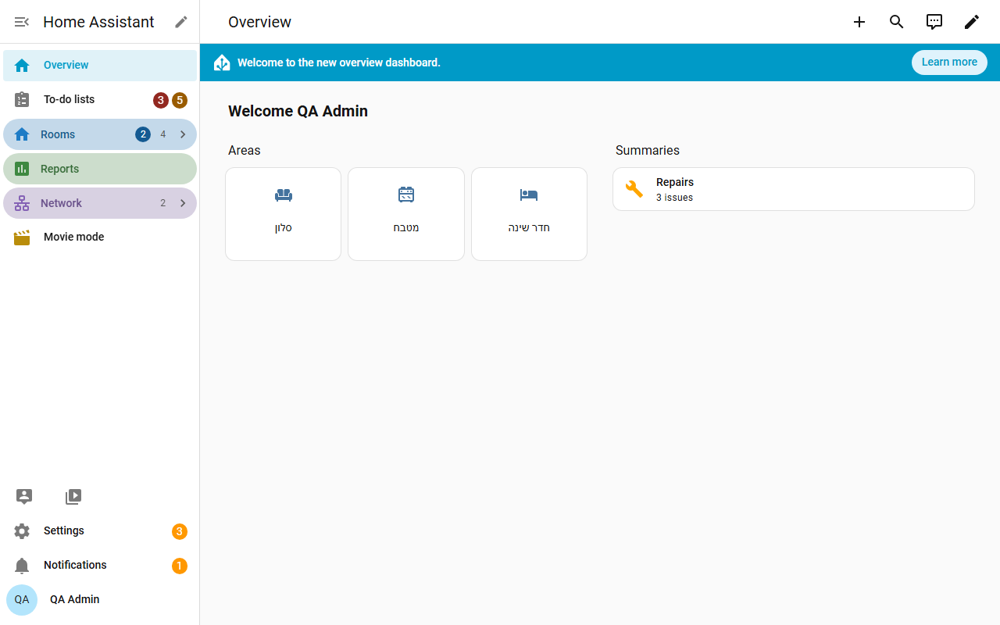
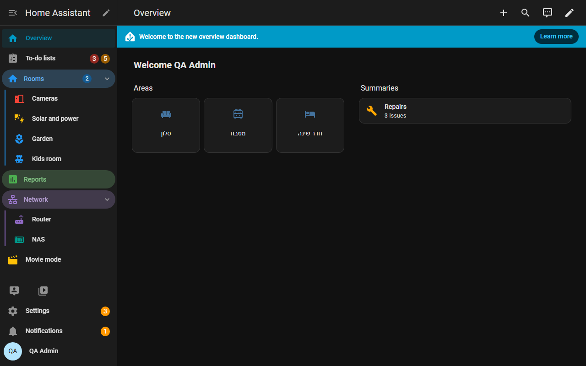

# Easy Sidebar Pro

Easy Sidebar Pro adds **collapsible groups** to the Home Assistant sidebar, and you edit them right inside the sidebar with drag and drop. Drop one row onto another and you have a group. Hebrew and English, right-to-left aware.

[Install](install.md){ .md-button .md-button--primary }
[GitHub](https://github.com/bareli/easy_sidebar_pro){ .md-button }

## Why

The Home Assistant sidebar is one flat list. With many dashboards and add-on panels it gets long, and Home Assistant's own "Edit sidebar" dialog can only reorder and hide. Easy Sidebar Pro gives you structure without leaving the sidebar.

- **Edit in place.** Press the pencil next to the sidebar title, drag rows, name the new group.
- **Same layout everywhere.** The layout is stored in Home Assistant for your user, not in the browser, so it follows you to every computer, tablet, phone and the companion app.
- **No flicker.** Groups are drawn as part of Home Assistant's own sidebar, not patched in afterwards.
- **Admin default.** An admin can give every user who has not made their own layout the same sidebar.
- **Works with Home Assistant's own settings.** Order and hidden panels are also written to Home Assistant's own sidebar settings.
- **No YAML.** Add the integration and use the pencil.

## What you can do

| Feature | Page |
|---|---|
| Groups, drag and drop, colours, header styles, folding, tabs groups, phone tab bar, pinned area | [Groups and editing](groups.md) |
| Items that open a Home Assistant page or a web address (router, NAS) | [Links](links.md) |
| Items that toggle an entity, show its details or call a service | [Action rows](actions.md) |
| Move to, badges, show only when, search words, icon colour, state rules, rename, hold and double tap | [Item options](items.md) |
| Display options, search box, theme variables | [Settings and themes](settings.md) |
| Export and import a layout, per-user layout and the admin default | [Export, import and defaults](export-import.md) |

## Requirements

- Home Assistant **2026.6 or newer** (tested on 2026.6.4, 2026.7.4, 2026.8.3 and 2026.9.4). It is built for the current sidebar (the `ha-list-nav` rows introduced in Home Assistant 2026.5). On older versions the integration loads but leaves the sidebar untouched.
- HACS for the easy install (a manual copy also works).
- Do not use it together with another sidebar plugin that changes the panel list, for example Sidebar Organizer: both change the same sidebar and the result is unpredictable.

!!! note "If Home Assistant changes the sidebar"
    If a future Home Assistant release changes the sidebar internals, Easy Sidebar Pro switches itself off and the normal sidebar stays. Your layout is kept.
