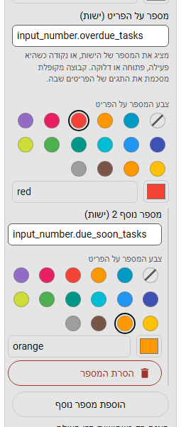
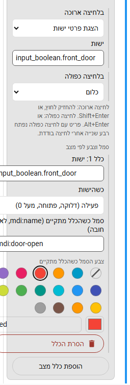

# אפשרויות פריט

לוחצים על הכפתור **⋮** בשורה בעורך (**אפשרויות נוספות** בקבוצה) כדי לפתוח את האפשרויות שלה. בלוק אפשרויות אחד פתוח בכל פעם. שדות נשמרים ב-Enter או כשעוזבים אותם.

שדות ישות מציעים ישויות תוך כדי הקלדה של שמן בכל שפה או של המזהה שלהן ("שם ידידותי (entity_id)", עד 8; חצים ו-Enter, או נגיעה). השדה שומר את מזהה הישות. העורך מזהיר מתחת לשדה כשישות לא קיימת ב-Home Assistant; השמירה עדיין מותרת.

## שם בסרגל הצד (שינוי שם ללוחות)

בלוחות של Home Assistant עצמה, **שם בסרגל הצד** מחליף את השם. סרגל הצד, האזור המוצמד, סרגל הלשוניות והעורך מציגים אותו, והחיפוש מוצא גם את השם החדש וגם את השם של Home Assistant. ריק פירושו השם של Home Assistant (1 עד 50 תווים).

## העברה אל

מעבירים את הפריט לקבוצה, חזרה לרמה העליונה או לאזור המוצמד, בלי לגרור.

## מספרים על הפריט (תגים)

**ישות למספר** מציגה את המספר שלה על הפריט, כמו מונה העדכונים של Home Assistant ליד "הגדרות", למשל `sensor.open_windows`. ישות שדלוקה, פתוחה או פעילה מציגה נקודה. כבוי, סגור, נעול, לא זמין, לא ידוע, במנוחה, בהמתנה, לא בבית, מנוטרל, בעגינה, מושהה, 0 וערכים שליליים לא מציגים כלום.

- קבוצה מקופלת, וקבוצה כלשוניות, מציגות את המספרים של הפריטים שלהן מסוכמים.
- לכל מספר אפשר לתת **צבע** משלו: צבע ערכת נושא או `#rrggbb`. הצבע מוכהה מתחת למספר הלבן כדי שיישאר קריא.
- ללוח או לקישור אפשר להוסיף **עד שלושה מספרים נוספים** (**הוספת מספר נוסף**), לכל אחד ישות וצבע משלו. לקבוצה יש מספר אחד בלבד.
- מספרים פעילים מוצגים זה לצד זה. פס הסמלים הצר מציג את הראשון הפעיל על הסמל.

למשל, מספר אדום למשימות באיחור ומספר כתום למשימות שמועדן קרוב:

## הצגה רק כשהישות פעילה

הפריט, או קבוצה שלמה, מופיע רק כשהישות דלוקה, פתוחה או מעל 0. למשל קבוצת "אזעקה" רק כש-`input_boolean.alarm` דלוק. כבוי, סגור, 0 ולא זמין מסתירים אותו. בעורך, סימן ברק קטן מראה אילו שורות יש בהן מספר או כלל הצגה (הטקסט שלו מציין את הישויות), ושורה שהכלל מסתיר כרגע מעומעמת עם הסיבה.

## מילות חיפוש

שמות נוספים שתיבת החיפוש מוצאת את הפריט לפיהם, למשל השם באנגלית. ראו על תיבת החיפוש ב[הגדרות וערכות נושא](settings.md).

## צבע הסמל

בלוחות, בקישורים ובשורות פעולה: צבע ערכת נושא או `#rrggbb` מותאם לסמל של הפריט. הוא גובר על צבע הסמל של הקבוצה. הפריט הנבחר שומר על ההדגשה של Home Assistant עצמה. כמו צבעי קבוצות, הוא מותאם לניגודיות בערכת הנושא שלכם.

## סמל וצבע לפי מצב

עד **שלושה כללים לפריט** (לוחות, קישורים ושורות פעולה). כשישות **פעילה** (דלוקה, פתוחה, מעל 0) או **לא פעילה**, הסמל ו/או צבע הסמל של הפריט משתנים. הכלל הראשון שמתקיים מנצח והצבע שלו גובר על צבע הסמל של הפריט ושל הקבוצה. למשל סמל דלת שהופך לאדום כשהדלת פתוחה:

## לחיצה ארוכה ולחיצה כפולה

כל פריט (לוח, קישור או שורת פעולה) יכול להריץ פעולה ב**לחיצה ארוכה** וב**לחיצה כפולה**: החלפת מצב של ישות, הצגת פרטים, הפעלת שירות או פתיחת דף.

| מחווה | עכבר או מגע | מקלדת |
|---|---|---|
| לחיצה ארוכה | לחיצה והחזקה חצי שנייה | Shift + Enter |
| לחיצה כפולה | לחיצה שנייה בתוך רבע שנייה | Alt + Enter |

- פריט עם לחיצה כפולה ממתין רבע שנייה אחרי לחיצה בודדת כדי לראות אם תבוא שנייה. פריטים בלעדיה נפתחים מיד.
- קוראי מסך שומעים את שתי המחוות בתיאור של השורה.
- המחוות לא פועלות בזמן עריכה.
