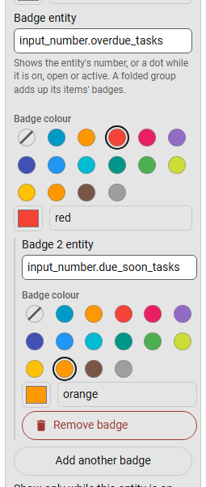
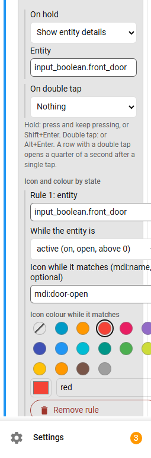

# Item options

Press the **⋮** button on a row in the editor (**More** on a group) to open its options. One options block is open at a time. Fields commit on Enter or when you leave them.

Entity fields suggest entities as you type their name in any language or their id ("Friendly name (entity_id)", up to 8; arrow keys and Enter, or tap). The field keeps the entity id. The editor warns under the field when an entity does not exist in Home Assistant; it still saves.

## Name in the sidebar (rename panels)

On Home Assistant's own panels, **Name in the sidebar** replaces the name. The sidebar, the pinned area, the tab bar and the editor show it, and the search finds both the new name and Home Assistant's own. Empty means Home Assistant's name (1 to 50 characters).

## Move to

Put the item into a group, back to the top level or into the pinned area, without dragging.

## Badges

A **badge entity** shows its number on the item, like Home Assistant's update count on Settings, for example `sensor.open_windows`. An entity that is on, open or active shows a dot. Off, closed, locked, unavailable, unknown, idle, standby, not home, disarmed, docked, paused, 0 and negative values show nothing.

- A folded group, and a tabs group, show their items' badges added up.
- Each badge can have its own **badge colour**: a theme colour or `#rrggbb`. The colour is darkened under the white number so it stays readable.
- A panel or a link can have **up to three more badges** (**Add another badge**), each with its own entity and colour. A group keeps a single badge.
- Active badges show side by side. The narrow icon rail shows the first active one on the icon.

For example, a red badge for overdue tasks and an orange one for tasks due soon:

## Show only while this entity is on

The item, or a whole group, appears only while the entity is on, open or above 0. For example an "Alarm" group only while `input_boolean.alarm` is on. Off, closed, 0 and unavailable hide it. In the editor, a small lightning mark shows which rows have a badge or a show-only-when rule (its tooltip names the entities), and a row its rule hides right now is dimmed with the reason.

## Search words

Other names the search box finds the item by, for example its English name. See the search box under [Settings and themes](settings.md).

## Icon colour

On panels, links and action rows: a theme colour or a custom `#rrggbb` for the item's icon. It wins over its group's icon colour. The selected item keeps Home Assistant's own highlight. Like group colours, it is adjusted for contrast on your theme.

## Icon and colour by state

Up to **three rules per item** (panels, links and action rows). While an entity is **active** (on, open, above 0) or **inactive**, the item's icon and/or icon colour change. The first matching rule wins and its colour beats the item's icon colour and the group's. For example a door icon turning red while the door is open:

## Hold and double tap

Any item (a panel, a link or an action row) can run an action on a **hold** and on a **double tap**: toggle an entity, show details, call a service or open a page.

| Gesture | Pointer | Keyboard |
|---|---|---|
| Hold | press and keep for half a second | Shift + Enter |
| Double tap | a second click within a quarter of a second | Alt + Enter |

- A row with a double tap waits a quarter of a second after a single tap to see whether a second one follows. Rows without one open at once.
- Screen readers hear both gestures in the row's description.
- Gestures do not run while you edit.
