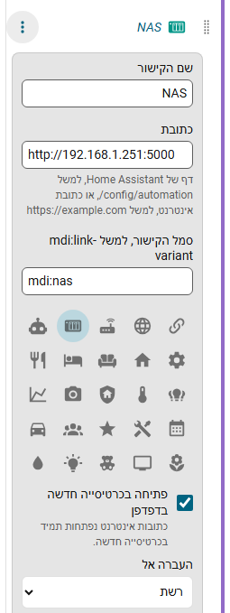

# קישורים

**הוספת קישור** בעורך מוסיפה פריט שאינו לוח של Home Assistant. קישור מצביע אל:

- **דף של Home Assistant**, למשל `/config/automation`, `/lovelace/cameras` או `/config/integrations`, או אל
- **כתובת אינטרנט**, למשל הנתב, ה-NAS או `https://example.com`.

נותנים לו שם וסמל. אפשר לשים קישור בקבוצה, להצמיד אותו ולהפוך אותו ללשונית, כמו כל פריט אחר.

## איפה הוא נפתח

- כתובות אינטרנט נפתחות בכרטיסייה חדשה בדפדפן.
- דף של Home Assistant נפתח באותה כרטיסייה. האפשרות **פתיחה בכרטיסייה חדשה בדפדפן** משנה זאת.
- קישור לדף מודגש בזמן שהדף הזה, או דף שמתחתיו, פתוח.

## הקלדת כתובות

אפשר להקליד כתובת בלי `http://` או `https://`. השדה מראה את התוצאה.

| מקלידים | מקבלים |
|---|---|
| `192.168.1.251:5000`, `nas.local`, `router.lan`, `localhost`, כל כתובת עם פורט | `http://...` |
| `example.com` | `https://example.com` |
| `energy` (מילה אחת) | הדף `/energy` של Home Assistant |
| `config/automation` | `/config/automation` |

"סיום" מסרב לשמור קישור בלי כתובת תקינה וממקד את השדה. לקישורים אין כפתור עין, כי הם אינם לוחות של Home Assistant; מוחקים קישור מתוך האפשרויות שלו.
