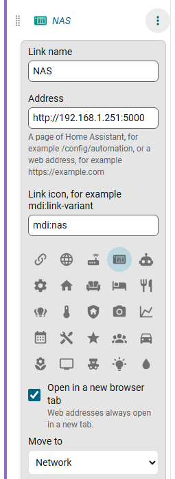

# Links

**Add link** in the editor adds an item that is not a Home Assistant panel. A link points to:

- a **page of Home Assistant**, for example `/config/automation`, `/lovelace/cameras` or `/config/integrations`, or
- a **web address**, for example your router, your NAS or `https://example.com`.

Give it a name and an icon. A link can be grouped, pinned and be a tab like any other item.

## Where it opens

- Web addresses open in a new browser tab.
- A Home Assistant page opens in the same tab. The option **Open in a new browser tab** changes that.
- A link to a page is highlighted while that page, or a page under it, is open.

## Typing addresses

You can type an address without `http://` or `https://`. The field shows the result.

| You type | You get |
|---|---|
| `192.168.1.251:5000`, `nas.local`, `router.lan`, `localhost`, any address with a port | `http://...` |
| `example.com` | `https://example.com` |
| `energy` (a single word) | the Home Assistant page `/energy` |
| `config/automation` | `/config/automation` |

Done refuses a link without a valid address and puts the focus on the field. Links have no eye button because they are not Home Assistant panels; delete one from its options.
