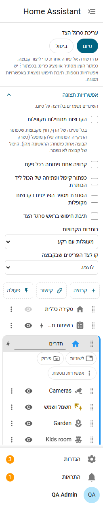

# הגדרות וערכות נושא

## אפשרויות תצוגה

פותחים את **אפשרויות תצוגה** בראש העורך, מתחת ל"סיום" ו"ביטול". השינויים נשמרים בלחיצה על **סיום**. הם חלק מהפריסה שלכם, ולכן עוקבים אחריכם לכל מכשיר, ומנהל יכול לכלול אותם בברירת המחדל.



| אפשרות | מה היא עושה |
|---|---|
| הקבוצות מתחילות מקופלות | כל קבוצה מתחילה מקופלת בכל טעינה של הדף, חוץ מקבוצות שכפתור התיקייה הפתוחה שלהן מופעל |
| קבוצה אחת פתוחה בכל פעם | פתיחת קבוצה מקפלת את האחרות |
| כפתור קיפול ופתיחה של הכול ליד הכותרת | כפתור ליד כותרת הסרגל (שתי קבוצות או יותר). עם "קבוצה אחת פתוחה בכל פעם" הוא רק מקפל |
| הסתרת מספר הפריטים בקבוצות מקופלות | מסתירה את המספר בכותרות מקופלות; קוראי מסך עדיין שומעים אותו |
| תיבת חיפוש בראש סרגל הצד | ראו למטה. כבויה כברירת מחדל |
| כותרות הקבוצות | רגילות, רקע צבעוני, קו מעל, או מעוגלות עם רקע |
| קו לצד הפריטים שבקבוצה | להציג או להסתיר |

ב**מעוגלות עם רקע** הכותרת היא גלולה שבהירה במדרגה מהסרגל בערכות נושא כהות וכהה במדרגה בערכות בהירות, בגוון הצבע של הקבוצה אם יש לה צבע. הטקסט, המספרים והסמלים עליה מותאמים לניגודיות.

## תיבת חיפוש

מפעילים **תיבת חיפוש בראש סרגל הצד** ומקלידים חלק משם כדי לראות רק את הפריטים ששמם מכיל אותו (בלי הבדל בין אותיות גדולות וקטנות, ובלי הבדל בסימנים), עם הקבוצות שלהם פתוחות.

- היא מוצאת גם את השמות באנגלית של Home Assistant ללוחות מובנים (מקלידים "his" וקיבלתם את היסטוריה בכל שפה), קישורים לפי שם או כתובת, [מילות חיפוש](items.md) של פריט ולוחות ששינו להם שם, לפי שני השמות.
- היא מוצאת את התצוגות של לוחות המחוונים שלכם, ומציגה אותן כ"תצוגה · לוח מחוונים".
- קבוצה כלשוניות מוצגת כשורה אחת שלה אם שמה או אחד מהפריטים שלה תואמים.
- **Enter** פותח את התוצאה הראשונה, **חץ למטה** עובר אל התוצאות, **Escape** מנקה.
- היא מוסתרת בסרגל צד של סמלים בלבד.

## משתני ערכת נושא

ערכות נושא יכולות לעצב את הקבוצות. צבע שהוגדר לקבוצה בעורך גובר עליהם.

| משתנה | מה הוא משנה |
|---|---|
| `esp-group-header-text-color` | שם כותרת הקבוצה |
| `esp-group-header-icon-color` | סמל כותרת הקבוצה |
| `esp-group-header-background` | רקע הכותרת כשהכותרות "עם רקע צבעוני" או "מעוגלות" |
| `esp-group-header-radius` | עיגול פינות הכותרת (גם של כותרות "מעוגלות") |
| `esp-group-divider-color` | הקו לצד הפריטים שבקבוצה, וכותרות "קו מעל" |
| `esp-group-divider-width` | רוחב הקו לצד הפריטים שבקבוצה (ברירת מחדל 2px) |

דוגמה לשורה בערכת נושא:

```yaml
esp-group-divider-color: "#7e57c2"
```

## צבעים

צבעי קבוצות, צבעי סמלים וצבעי מספרים מקבלים את אותם ערכים: צבע ערכת נושא של Home Assistant (theme, accent, red, pink, purple, indigo, blue, cyan, teal, green, lime, amber, orange, brown, grey) או צבע `#rrggbb`. צבעי ערכת נושא עוקבים אחרי ערכת הנושא במצב בהיר וכהה. כשצבע היה קשה לקריאה הוא מותאם אוטומטית: 4.5:1 לשמות, 3:1 לסמלים ולקווים. מעבר בין בהיר לכהה מעדכן את הצבעים מיד.
