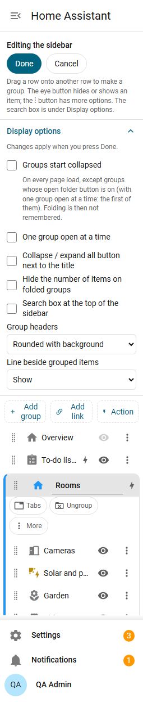

# Settings and themes

## Display options

Open **Display options** at the top of the editor, under Done and Cancel. Changes apply when you press **Done**. They are part of your layout, so they follow you to every device, and an admin can include them in the default.



| Option | What it does |
|---|---|
| Groups start collapsed | Every group starts folded on every page load, except groups with the open folder button on |
| One group open at a time | Opening a group folds the others |
| Collapse / expand all button next to the title | A button next to the sidebar title (two or more groups). With "one group open at a time" it only collapses |
| Hide the number of items on folded groups | Hides the count on folded headers; screen readers still hear it |
| Search box at the top of the sidebar | See below. Off by default |
| Group headers | Plain, Tinted background, Line above, or Rounded with background |
| Line beside grouped items | Show or hide |

For **Rounded with background**, the header is a pill a step lighter than the sidebar on dark themes and a step darker on light ones, tinted with the group's colour if it has one. Text, counts and icons on it are adjusted for contrast.

## Search box

Turn on **Search box at the top of the sidebar** and type part of a name to see only the items whose names contain it (any case, accents ignored), with their groups unfolded.

- It also finds Home Assistant's own English names of built-in panels (type "his" for History in any language), links by name or address, an item's [search words](items.md#search-words) and renamed panels by both names.
- It finds the views of your dashboards, shown as "View · Dashboard".
- A tabs group shows as its one row if its name or any of its items match.
- **Enter** opens the first result, **Down** moves into the results, **Escape** clears.
- It is hidden in the icon-only sidebar.

## Theme variables

Themes can restyle the groups. A colour set on a group in the editor wins over these.

| Variable | What it changes |
|---|---|
| `esp-group-header-text-color` | group header name |
| `esp-group-header-icon-color` | group header icon |
| `esp-group-header-background` | header background when headers are "tinted" or "rounded" |
| `esp-group-header-radius` | header corner radius (also of "rounded" headers) |
| `esp-group-divider-color` | line beside grouped items, and "line above" headers |
| `esp-group-divider-width` | width of the line beside grouped items (default 2px) |

Example theme entry:

```yaml
esp-group-divider-color: "#7e57c2"
```

## Colours

Group colours, icon colours and badge colours all take the same values: a Home Assistant theme colour (theme, accent, red, pink, purple, indigo, blue, cyan, teal, green, lime, amber, orange, brown, grey) or a `#rrggbb` colour. Theme colours follow your theme in light and dark mode. When a colour would be hard to read it is adjusted automatically: 4.5:1 for names, 3:1 for icons and lines. Switching between light and dark updates the colours right away.
